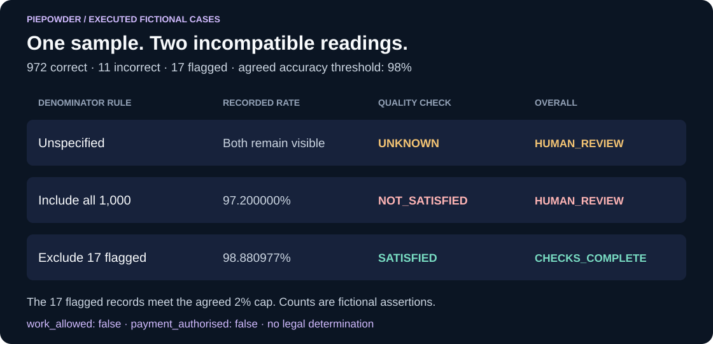

# Piepowder

**Make acceptance criteria explicit. Preserve the evidence. Show what still needs a human decision.**

Piepowder is a public experimental research prototype for reviewing contracts and evidence
in commerce between agents. Version **0.1.0a1** provides a working local engine,
a procedural simulator and a self-contained viewer. All shipped cases are fictional.

The founding report proposes a broader agent judiciary. This first build tests
its prevention-first idea through one narrow problem: two parties can agree on
98% accuracy while disagreeing about which records count in the denominator.

## See it in action

Feed the local reviewer a fictional contract, its acceptance rule and a sample
with 972 correct, 11 incorrect and 17 flagged records. The same sample can fall
below or above 98%, depending on which denominator the parties actually agreed.



This is an illustration of executed numerical checks. An unspecified rule
remains `UNKNOWN` and requires human review. `CHECKS_COMPLETE` grants no legal
determination, work permission or payment authority. The inputs are fictional.

From an authorised checkout under [RIGHTS.md](RIGHTS.md), with Python 3.10 or later:

```sh
PYTHONPATH=src python -m piepowder demo --output artifacts/readme-demo
```

[Recorded six-case results and reproduction notes](docs/demo/README.md) ·
[Generated offline viewer](docs/demo/index.html) (open the file from your checkout;
GitHub displays its source).

## See it work

Python 3.10 or later; no runtime or test dependencies outside the standard library.
Read [RIGHTS.md](RIGHTS.md) before use. From an authorised checkout:

```bash
PYTHONPATH=src python -m piepowder demo --output artifacts/first-run
PYTHONPATH=src python -m unittest discover -s tests -v
```

Open `artifacts/first-run/dashboard.html` locally. Select each scenario to inspect
the actual engine findings, numerical alternatives, evidence digests and remaining
questions. The page contains all its data and makes no network requests.

Windows PowerShell:

```powershell
$env:PYTHONPATH = "src"
python -m piepowder demo --output artifacts/first-run
python -m unittest discover -s tests -v
```

Use a new output directory for each run. Existing demonstration files are preserved.
The editable-install command `python -m pip install -e .` also exposes `piepowder`;
the direct source commands above avoid any installation or package download.

## The first demonstrated problem

An invented sample contains 972 correct records, 11 incorrect records and 17
flagged as unresolvable. Its contract specifies a 98% accuracy threshold.

| Agreed treatment | Exact calculation | Engine observation |
| --- | --- | --- |
| Unspecified | Both calculations remain visible | Human interpretation required |
| Include all sampled records | 972 / 1000 = 97.2% | Stated numerical criterion not satisfied |
| Exclude flagged records | 972 / 983 = 98.8809766…% | Stated numerical criterion satisfied, subject to the agreed flag cap |
| Evidence contested, conflicting or missing | A reliable supported conclusion is unavailable | Unknown, with reasons |

These are checks of supplied counts. No real addresses are geocoded, no reference
service is queried and no sampling method is independently verified. The engine
never selects a legal interpretation merely to make a result pass.

## What is implemented

| Component | Current behaviour |
| --- | --- |
| Typed contract compiler | Duty graph and structural findings for tests, assessors, parties, triggers, deadlines and recorded mandate references |
| Acceptance profile | One exact geocode-count profile, with explicit denominator and exception treatment |
| Recorded mandates | Formation-time comparisons of agent, counterparty, amount, currency, validity, revocation and allowed action |
| Evidence reader | Bounded local files, exact-byte SHA-256 comparison, safe paths, typed counts, conflicting and missing evidence |
| Dossier binding | Versioned hashes of contract, mandates, policy, case and observed evidence |
| Procedural simulator | Filing, answering, evidence closure/reopening, technical assessment, timeout referral and human-review handoff |
| Reports | Reproducible JSON, readable Markdown and an offline scenario viewer |
| Verification | Unit and integration coverage of malformed inputs, containment, numerical boundaries, replay and procedural guards |

The compiler handles expressly typed duties. It does not derive an authoritative
contract from prose, resolve all contradictions, or estimate semantic ambiguity
through a panel of models. Prose and quoted evidence remain uninterpreted.

## Interpret the result correctly

`INVALID` means the input is outside the supported format or contains structural
errors. `HUMAN_REVIEW` means a check is unresolved, contested or not satisfied.
`CHECKS_COMPLETE` means the supported deterministic checks of recorded assertions
completed successfully. A successful check establishes only its stated observation.

Every analysis retains `work_allowed: false` and `payment_authorised: false`.
The `assurance` section records the absence of verified identity, signatures,
legal authority, trusted timestamps and factual ground truth. Formation-time
mandate comparison does not verify authority for later delivery, filing or settlement.

The docket is a local simulation. Actor labels and recorded notice acknowledgements
are unauthenticated. A retained hash can detect changes relative to that checkpoint;
an internally consistent local chain does not prove that an administrator preserved
all earlier events. The system has no funds adapter, binding decision or live filing service.

## Other commands

```bash
PYTHONPATH=src python -m piepowder compile examples/geocode-ambiguous/contract.json
PYTHONPATH=src python -m piepowder analyse examples/geocode-ambiguous
PYTHONPATH=src python -m piepowder verify-docket artifacts/first-run/docket.json
```

For a saved checkpoint comparison, add `--expected-sha256 YOUR_RETAINED_HEAD_DIGEST`
to `verify-docket`. Retain that value independently from the editable dossier.
The digest in the same demonstration directory is a convenience, not an independent witness.

## Project boundaries

- **Piepowder:** acceptance clarity, supported evidence checks and preparation for independent review.
- **Symbolon:** the separate machine-work transaction workflow and its existing TEST-unit accounting sandbox.
- **RegNav:** mapped local source-change signals that can identify a need to reconsider evidence.

The [integration design](docs/integration.md) defines a proposed read-only interface.
No connector between the three projects is claimed to be implemented in this version.

## Help develop Piepowder

We welcome collaborators who want to make acceptance criteria and evidence easier
to inspect. Start with an original proposal or a reproducible problem in
[Issues](https://github.com/Albertito-AI/piepowder/issues). Useful starting points
include the fictional benchmark and first-use instructions, clearer explanations
of unresolved findings, and the local operator/input procedure.

Read [CONTRIBUTING.md](CONTRIBUTING.md) and [RIGHTS.md](RIGHTS.md) before implementing
or submitting code or documentation. Agree the contribution scope and applicable
permission with the maintainer first. Accepted contributions will be credited in
the relevant pull request or release notes using the contributor's preferred name
or GitHub handle.

Where funded work becomes available, collaborators can discuss paid development,
research, documentation or support. Roles, deliverables, intellectual-property
arrangements and payment terms must be agreed in writing before that work begins.
Earnings and revenue-sharing arrangements depend on a specific agreement.

## Development record

- [Architecture and supported data language](docs/architecture.md)
- [Schemas and authoring limits](spec/README.md)
- [Market and source corrections](docs/market-and-source-review.md)
- [Legal and source review](docs/legal-and-source-review.md)
- [Mathematical qualifications](docs/mathematics.md)
- [Commercial validation plan](docs/commercial-plan.md)
- [Milestones](docs/roadmap.md) and [decisions](docs/decisions.md)
- [Validation evidence](docs/validation.md)
- [Continuing improvement](docs/continuous-improvement.md)
- [Security](SECURITY.md), [governance](GOVERNANCE.md) and [rights](RIGHTS.md)

Project owner: **Albert Tan Sin Hon**, GitHub `Albertito-AI`.
Piepowder remains a working name. Repository visibility is public; the reserved
rights in RIGHTS.md continue to apply. Customer work follows the owner's verification,
agreement, actual bank-receipt and scoped release requirements.
