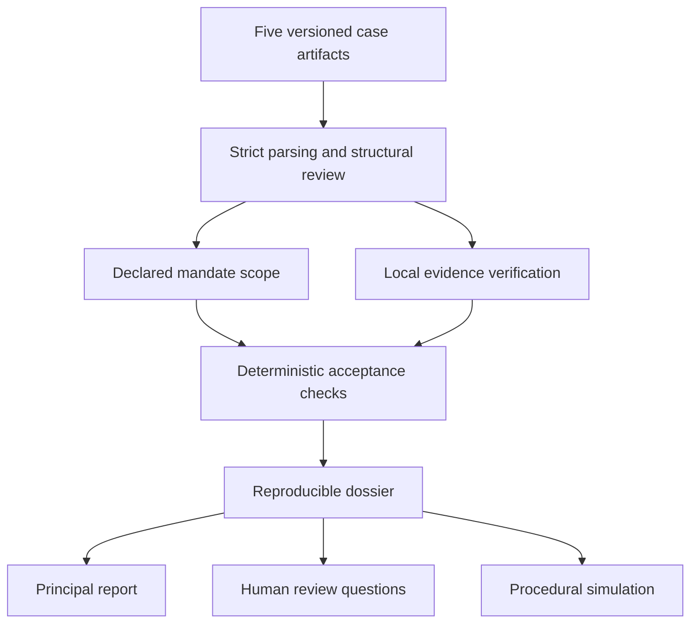

# Architecture and supported data language

Version 0.1.0a1 uses a small Python standard-library implementation. The report's
multi-service architecture remains a possible destination. A single offline core
lets us test the acceptance and evidence model before paying the operational cost
of a service, protocol endpoint, model panel or custody integration.

## Data flow

The case directory contains `case.json`, `contract.json`, `mandates.json`,
`policy.json` and `evidence.json`, plus files under `evidence/`. Each document
declares its supported schema version. The authoring schemas are in `spec/`;
runtime validation also checks relationships that JSON Schema does not express.

The JSON profile is intentionally restricted: UTF-8 object documents, unique
keys, bounded size/depth/item counts, whole integer number tokens and explicit
UTC timestamps at whole-second resolution. Prices are integer minor units and
thresholds are integer basis points. The currency field is a three-letter
identifier; the engine does not independently validate a currency registry or
infer a minor-unit exponent. Every example's USD amount is fictional.

## Contract and mandate review

The compiler reads named parties and typed obligations into a duty graph. It
checks references, completeness and supported date/acceptance structure. It
does not implement every Hohfeldian legal relation or compile a free-text
contract into legally conclusive code. The same evidence can yield different
numerical observations when the parties expressly choose different criteria.

Recorded mandate checks apply to `form_contract` at `formed_at`. They compare
the supplied principal/agent labels, counterparty, value, currency, interval,
revocation and action scope. Actual identity, signature validity and legal
authority remain unverified. Authority for later events is explicitly not checked.

## Byte commitments and reproducibility

The agreement digest hashes a versioned envelope containing SHA-256 values for
the exact original contract, mandate and policy bytes. Whitespace changes to
one of those artifacts therefore produce a different digest. This records what
the program read; it does not prove that both parties agreed to those bytes.

The dossier digest binds the five artifact digests and the observed evidence
digests/statuses. It identifies the input dossier, not an independently signed
decision. A complete analysis file has its own file digest when exported. The
demonstration docket references that complete analysis digest.

Evidence identifiers must be unique and map to named duties and submitters.
The reader checks local path containment, byte limits, regular-file identity,
declared hashes and sample structure. Two inconsistent submissions for the same
duty, missing files and explicit contests remain visible. An unavailable or
tampered file does not establish who breached a contract.

## The numerical profile

`geocode_accuracy` consumes recorded counts, an agreed sample size, a threshold,
a denominator choice and a maximum flagged-record rate. It displays both
denominator readings and uses exact integer comparisons for the selected rule.
No probability of correctness or legal interpretation is inferred. Population
accuracy, the reference service and sampling method are outside this profile.

The overall states are `INVALID`, `HUMAN_REVIEW` and `CHECKS_COMPLETE`. Individual
checks use `SATISFIED`, `NOT_SATISFIED`, `UNKNOWN` and `NOT_RUN`. Reports preserve
those distinctions; the same record never creates a work or payment authorisation.

## Procedural simulation

The separate docket module records fictional filing, notice recipients, answers,
evidence admission, closure, reopening, technical-assessment references and
referral. Actor labels and acknowledgement fields are supplied claims. A late
answer is preserved. A recorded timeout triggers review without declaring a winner.

Closing evidence requires recorded answers and acknowledgements from both party
labels and admission of the committed index. Reopening preserves history and
supersedes the prior assessment. This version reopens review of the same index;
adding a newly committed evidence artifact needs a later versioned-amendment design.

Events are hash-linked and replayed. Exact retries are idempotent; conflicting
IDs and stale expected heads are rejected. A separately retained expected head
can detect truncation relative to that checkpoint. Local checks do not establish
trusted time, externally witnessed append-only history, legally valid notice or
signature authority. There is no settlement, award or funds-execution action.

An assessment event checks the format of its supplied digest, recognised status
and admitted citation identifiers. It does not load the referenced assessment
body and independently match its agreement and dossier bindings to the docket.
The event therefore records a synthetic assessment reference. The demonstration
CLI supplies the digest of its actual analysis file, but this convenience is not
authenticated assessment provenance for arbitrary callers.

## Production work deliberately left for later

Authenticated principals and per-event delegation, confidential storage and
retention, trusted notices/timestamps, independently witnessed records, server
concurrency/recovery, formal modelling, model-panel evaluation and any live
institutional or payment interface require separately evidenced milestones.
The current unit tests and replay checks are executable tests, not TLA+ model checking.
